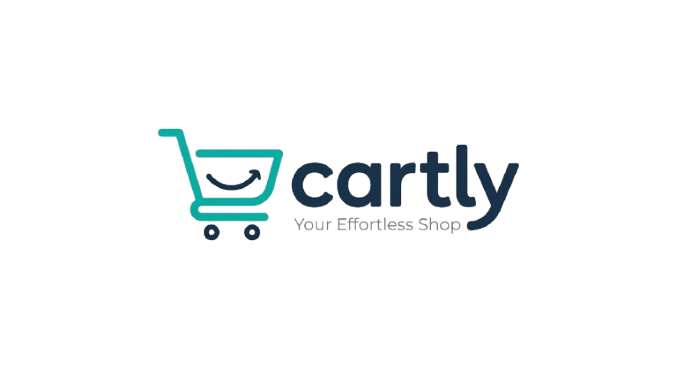

# 🛒 Cartly — E-Commerce Web Application

<p align="center">
  
</p>

<p align="center">
  A modern e-commerce web application built with ASP.NET Core MVC and Web API.
  <br/>
  Browse products, manage your cart, save favourites, and manage orders through a responsive shopping experience.
</p>

## 🧰 Tech Stack

<p align="center">
  
  
  
</p>

<p align="center">
  
  
  
  
  
</p>

<p align="center">
  
  
  
</p>

<p align="center">
  
  
  
  
</p>

<p align="center">
  
  
  
</p>

<p align="center">
  <!-- Add your deployed application URL when available -->
  <a href="YOUR_LIVE_DEMO_URL">Live Demo</a> •
  <a href="YOUR_API_DOCUMENTATION_URL">API Documentation</a> •
  <a href="YOUR_GITHUB_ISSUES_URL">Report an Issue</a>
</p>

---

## 📸 Project Preview

<!-- Replace the placeholders below with screenshots of your application -->

<p align="center">
  
  <br/>
  <em>Homepage — replace this image with your actual screenshot.</em>
</p>

| Product Browsing | Shopping Cart |
|:---:|:---:|
|  |  |
| *Add product listing screenshot* | *Add cart screenshot* |

| Authentication | Orders & Checkout |
|:---:|:---:|
|  |  |
| *Add login or registration screenshot* | *Add checkout or order screenshot* |

---

## ✨ Overview

**Cartly** is a full-stack e-commerce project developed to practise and demonstrate modern web application development using the .NET ecosystem.

The application combines ASP.NET Core MVC pages with API controllers in the same project. It uses Dapper and stored procedures for database operations, while Entity Framework Core is used for selected features.

The project focuses on practical software development concepts, including authentication, service-layer architecture, database integration, asynchronous client-side requests, and maintainable code organization.

## 🚀 Features

- 🔐 **Authentication** — Customer registration and login using JWT-based authentication.
- 🌐 **Google Sign-In** — Google OAuth integration for customer authentication.
- 🛍️ **Product Catalogue** — Browse products, categories, and subcategories.
- 🔎 **Product Search** — Search for products and view product details.
- 🛒 **Shopping Cart** — Add, update, remove, and manage cart items.
- ❤️ **Wishlist** — Save and manage favourite products.
- 📦 **Order Management** — Create orders and view order details.
- 💳 **Checkout & Payments** — Checkout and payment-related application flows.
- 👤 **Customer Profile** — View and manage customer profile information.
- 🔄 **Token Refresh** — Refresh-token workflow for maintaining authenticated sessions.
- ✉️ **Email Services** — Background email-processing components.
- ⚡ **AJAX Integration** — Dynamic client-side interactions using JavaScript and jQuery.

> Note: Payment processing, email delivery, and other external integrations depend on their respective configurations and service implementations.

## 🧰 Tech Stack

| Category | Technologies |
|---|---|
| Frontend | HTML5, CSS3, JavaScript, jQuery, Bootstrap |
| Backend | C#, ASP.NET Core MVC, ASP.NET Core Web API |
| Framework | .NET 8 |
| Database | Microsoft SQL Server |
| Data Access | Dapper, SQL Stored Procedures |
| ORM | Entity Framework Core |
| Authentication | JWT, Google OAuth |
| API Testing | Swagger / OpenAPI, Postman |
| Development Tools | Visual Studio 2022, Git, GitHub |

## 🏗️ Architecture

Cartly uses a combined MVC and Web API approach within a single ASP.NET Core project.

```text
ShoppingCartCustomerMVC
│
├── Controllers
│   ├── MVC_Controller
│   │   └── Web page controllers
│   │
│   └── API_Controller
│       └── REST API controllers
│
├── Data
│   ├── DbConnectionFactory.cs
│   └── ShoppingCartDbContext.cs
│
├── Models
│   ├── Entities
│   └── ViewModels
│
├── Services
│   ├── API_Service
│   │   ├── AuthService
│   │   ├── CartService
│   │   ├── CategoryService
│   │   ├── CustomerService
│   │   ├── OrderService
│   │   ├── PaymentService
│   │   ├── ProductService
│   │   └── WishlistService
│   │
│   └── BackgroundService
│
├── Views
│   └── MVC Razor Views
│
├── wwwroot
│   ├── css
│   ├── js
│   ├── images
│   └── product_images
│
├── Program.cs
├── appsettings.json
└── ShoppingCartCustomerMVC.csproj
```

### Data access approach

- **Dapper + Stored Procedures:** Used for product, category, customer, order, payment, and related database operations.
- **Entity Framework Core:** Used for selected cart and wishlist operations.
- **Service Layer:** Keeps business and data-access logic separate from controllers.
- **DTOs / ViewModels:** Supports data transfer and presentation-specific models.

## 🔑 Authentication Flow

1. Customers register or sign in.
2. The application authenticates credentials and issues JWT tokens.
3. Authenticated API requests include the access token.
4. The client-side API helper attaches authentication headers where required.
5. The refresh-token workflow can request a new access token when appropriate.
6. Google OAuth supports an alternative sign-in flow.

<!-- Optional: Add a visual authentication-flow diagram here -->
<!-- Example file: docs/architecture/authentication-flow.png -->

## ⚙️ Getting Started

### Prerequisites

Install the following tools before running the application:

- [Visual Studio 2022](https://visualstudio.microsoft.com/)
- [.NET 8 SDK](https://dotnet.microsoft.com/download/dotnet/8.0)
- [SQL Server](https://www.microsoft.com/en-us/sql-server/) and SQL Server Management Studio (SSMS)
- [Git](https://git-scm.com/)

### 1. Clone the repository

```bash
git clone https://github.com/YOUR_USERNAME/ShoppingCartCustomerMVC.git
cd ShoppingCartCustomerMVC
```

### 2. Open the solution

Open `ShoppingCartCustomerMVC.sln` in Visual Studio 2022.

### 3. Configure application settings

Configure your local database connection, JWT signing key, Google OAuth credentials, and email settings as required.

Use **.NET User Secrets** for development secrets rather than committing passwords, API keys, or signing keys to source control.

From the project directory, initialize User Secrets if they have not already been initialized:

```bash
dotnet user-secrets init
```

Add your local configuration values using the appropriate secret keys referenced by the application.

### 4. Configure the database

- Create or select your SQL Server database.
- Create the required tables and stored procedures.
- Update the local connection string.
- Ensure the database schema matches the application's data models and queries.

<!-- Add your database setup instructions or SQL script location here -->
**Database setup:** `YOUR_DATABASE_SETUP_DOCUMENTATION_OR_SCRIPT_PATH`

### 5. Restore dependencies

```bash
dotnet restore
```

### 6. Run the application

```bash
dotnet run
```

Alternatively, select `ShoppingCartCustomerMVC` as the startup project in Visual Studio and press **F5**.

> The application requires valid local configuration and a compatible database schema before all features can work.

## 🧪 API Testing

Use Swagger/OpenAPI or Postman to explore and test the available API endpoints.

- **Swagger UI:** `YOUR_LOCAL_SWAGGER_URL`
- **Postman Collection:** `YOUR_POSTMAN_COLLECTION_LINK`

<!-- Optional: Add a screenshot of Swagger UI here -->


## 🗺️ Roadmap

- [ ] Add a complete project setup and database guide.
- [ ] Add screenshots and an application demonstration video.
- [ ] Publish a live demo.
- [ ] Add automated unit and integration tests.
- [ ] Improve deployment and production configuration documentation.
- [ ] Document API endpoints and authentication requirements.

Update this checklist as you complete each item.

## 📚 What I Learned

Through this project, I have practised:

- Building web applications using ASP.NET Core MVC and Web API.
- Designing service-based application architecture.
- Using Dapper, SQL Server, and stored procedures.
- Integrating Entity Framework Core for selected data operations.
- Implementing JWT authentication and Google OAuth.
- Working with AJAX requests and client-side API integration.
- Debugging and troubleshooting full-stack application issues.
- Managing source code with Git and GitHub.

## 👨‍💻 Author

**Midhun Kunjumon**

B.Tech in Computer Science and Engineering — Artificial Intelligence and Machine Learning

- GitHub: [YOUR_GITHUB_PROFILE](https://github.com/YOUR_USERNAME)
- LinkedIn: [YOUR_LINKEDIN_PROFILE](YOUR_LINKEDIN_URL)
- Portfolio: [YOUR_PORTFOLIO_URL](YOUR_PORTFOLIO_URL)

## 📄 License

This project is currently shared for portfolio and learning purposes.

<!-- If you choose an open-source license, add its name and a LICENSE file here. -->

---

<p align="center">
  Built with ❤️ using C# and ASP.NET Core.
</p>
